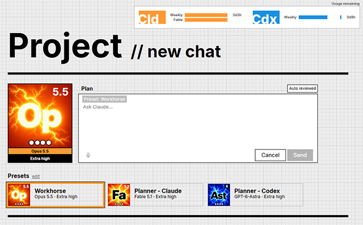
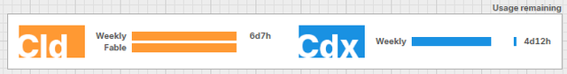
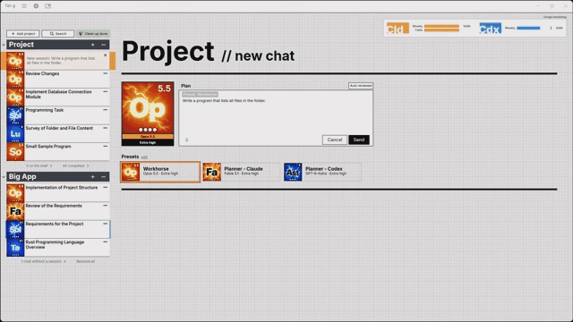
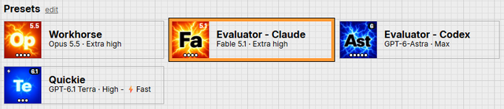
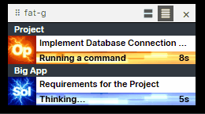
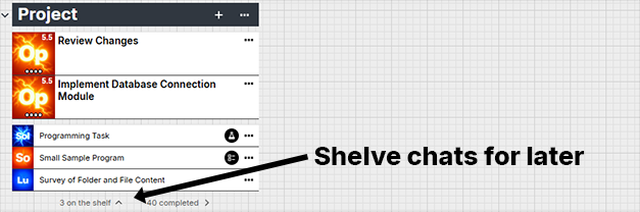
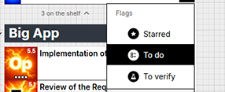
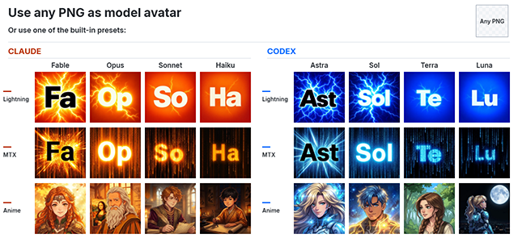

# fat-g: workflow-optimized, stylish desktop client for working with agents

## Claude and Codex in style: 100% free open-source, quick install

If we're going to be managing agents all day, let's make it satisfying and pretty!

fat-g ("Fun Agent Team - Go!") is a clean, Swiss-grid-inspired interface for working with your AI agents. It's a small project, but used daily in a production setting and improved constantly.

## Core features
**Multi-provider & multi-account:** Mix and match providers as you see fit. Know each limit at a glance.

**Dynamic visuals and sounds:** Not just eye candy; animations and visuals are part of an enhanced workflow. (the GIF is a bit wonky; it's smoother in the app)

**Presets:** One-click access to your "go-to" models and effort levels

**Animated status window:** A toggleable animated mini-window helps you keep tabs on progress, especially on multi-monitor setups. It conveniently also auto-hides when working in the main window.

**Shelving:** Temporarily put aside some tasks, or keep them handy as a reference or starting point for later.

**Tags ("TO DO" or "TO VERIFY"):** Mark chats so you know the status of your work. **Very useful in conjunction with the shelf** for work you will get back to or test later. Setting chats as "Done" archives chats and clears these tags automatically.

## Why so serious? Avatars for any model & **create your own**

## What's not in yet
fat-g is used to create production code daily, but its feature set is not fully on par with the full clients. Here's what's missing and what's coming up:

- Conversation branching / prompt editing -> **coming soon**
- Plan steps (currently on by default in Claude) -> easy to add if there's demand
- Computer use
- Partial MCP support: Tool calls and approvals work. Server-requested forms, browser-based interactions, and interactive MCP apps are not yet supported

### Made for extendability
Claude & Codex are supported today; other providers can be added with just some modifications to the source. New built-in providers will be added based on demand.

## Easy install: use fat-g immediately

fat-g uses **Claude Code or Codex installed on your computer**. You need to have either or both installed.

### Windows

**[Download fat-g for Windows (.exe)](https://github.com/fbdesignpro/fat-g/releases/latest)** and install.

Note: The installer is currently unsigned, so you may get a **Windows protected your PC** message. To move forward, select **More info**, then **Run anyway** (I plan to add code signing if there's enough demand for the project). You can run from source using the instructions below.

Once installation finishes, open **fat-g** from the Start menu. **No administrator rights are needed for the installation.**

### Mac

**[Download fat-g for Mac (.dmg)](https://github.com/fbdesignpro/fat-g/releases/latest)**, open the disk image, and drag **fat-g** into **Applications**. The Mac download is for Apple Silicon; on an Intel Mac, run from source using the instructions below.

Note: The app is not yet signed or notarized, so when you first open it macOS may say **Apple could not verify "fat-g" is free of malware** (on older versions: the **developer cannot be verified**). Choose **Done**, not Move to Trash. Then open **System Settings → Privacy & Security**, scroll to **Security**, select **Open Anyway** for fat-g, and confirm with your password (I plan to add signing and notarization if there's enough demand for the project). You can run from source using the instructions below.

Once installation finishes, open **fat-g** from **Applications**.

## Connect your Claude and Codex accounts

fat-g should **automatically detect** your existing clients (CLI). fat-g never signs you in itself: your account stays with the CLI, which signs in through its own command, in your terminal and browser. A CLI that is already installed and signed in is found when fat-g starts, so you can add a project and start a chat right away.

If a CLI is not signed in yet, open **Settings → Accounts**. Its UI reads **Sign-in needed** and shows three steps:

1. **Start the sign-in.** Press **Sign in with the CLI**: a terminal opens, runs `claude auth login` or `codex login`, and your browser shows the sign-in page.
2. **Finish signing in** in the browser, as the CLI asks.
3. **Come back and press Signed in, reconnect**: the UI shows the account and its usage.

If no sign-in page appears, the UI also has the command and a **Copy** button for a terminal of your own.

If the UI reads **CLI not found**, install the CLI (**Installation guide** opens the provider's own instructions) or, when it is installed somewhere fat-g does not look, expand **How to find the CLI executable** and choose the file.

**A second account of the same provider** (a work account, another plan): press **Add Claude account** or **Add Codex account**, give it a name and an empty folder of its own under **Account data folder**. The CLI keeps that account's sign-in, settings and history in that folder, apart from your first account's. The new UI shows the same three steps, with its command pointed at that folder.

## Run from source or contribute

Want to change the interface, add a provider, or see how it works? fat-g is built with Electron, React, and TypeScript, with separate layers for the desktop app, provider adapters, and interface.

The [development guide](docs/development.md) covers prerequisites, running from source, building an installer, and checking changes.

Bug reports and feature ideas are welcome in [Issues](https://github.com/fbdesignpro/fat-g/issues). Include your operating system, fat-g and CLI versions, and steps to reproduce the problem. Remove private conversation text, account details, and personal paths from anything you share.

## A few things to know

- **Your accounts stay yours.** Sign-in happens through the provider's CLI. fat-g never reads your credentials or handles your login.
- **Multiple accounts work side by side.** Use **Settings → Accounts → Add account** to give another account its own configuration folder and sign in through its CLI. Each account has its own usage display and model list.
- **Your chats are saved locally.** fat-g keeps conversations in its own data folder so you can return to them after a restart. Your prompts and the context an agent uses still go to its provider through the CLI. See [Privacy](PRIVACY.md) for what is stored, where, and how removal works.
- **Your project stays free of fat-g configuration files.** The app keeps its project settings in its own data folder. Agents can still edit your project's files according to the permissions you give them.
- **Updates are manual.** Download the newer installer or disk image from [Releases](https://github.com/fbdesignpro/fat-g/releases) and follow its update instructions. fat-g does not update itself or your CLIs. Uninstalling the app leaves its saved data in place; see [Privacy](PRIVACY.md#the-data-folder) to locate it.

## About the project

fat-g stands for **Fun Agent Team – Go!** It started as a tool for my own daily work: a way to manage several agents and projects while making the experience more satisfying to use. It's a small, independent project, shaped by that everyday use.

## Documentation & useful scripts

- [Development guide](docs/development.md): set up the source, run the app, and build packages.
- [Windows scripts](do/do-readme.md): the full reference for the `do-*.bat` shortcuts.
- [Custom avatars](docs/avatars.md): low-level info on the system.
- [Privacy](PRIVACY.md): your data, accounts, and project files.
- [Architecture and project guidelines](AGENTS.md) and [design decisions](docs/decisions/README.md): how the project fits together.

## License

fat-g is free and open source, provided "as is," without warranty, under the [MIT license](LICENSE). Bundled third-party components and assets retain their own licenses and notices.

fat-g is not affiliated with, endorsed by, or supported by Anthropic or OpenAI. Claude and Codex are trademarks of their respective owners, used here to describe compatibility.
